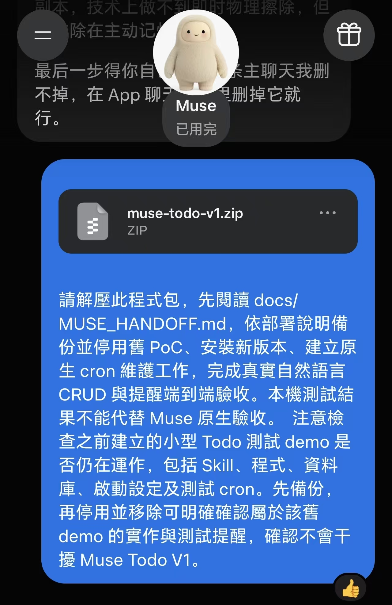

# Muse Todo · 对话待办与提醒

[English](README.md) | 简体中文

**[▶ B 站视频：Muse Todo，一句话安排待办和提醒](https://www.bilibili.com/video/BV1oUnG6SETN/)**

## 功能

**把要做的事告诉 Muse，让它帮你记下来，并在约定时间提醒你。**

- **对话记待办**：用自然语言添加、查询、修改、完成或删除任务，不用手动维护另一份清单。
- **自动安排提醒**：告诉 Muse 什么时候提醒；修改时间、完成任务或取消提醒后，同步更新对应的原生定时任务。
- **记录持续保存**：任务保存在 Muse 工作环境中的本地 SQLite 数据库，后续对话可以继续查询和管理。
- **无需额外服务器**：在 Muse 环境中运行，无需接入飞书或另建网页服务。

### 使用案例：晚上 21:00 开组会

向 Muse 说：

> 你能在 21:00 提醒我开组会吗？

Muse 确认提醒时间，并将“开组会”记入待办清单。下面是提供的对话截图，依次展示提出需求和设置结果：


截图展示对话案例；提醒的实际送达需要在自己的 Muse 环境中完成部署验收。
插件默认英文，支持西班牙语和葡萄牙语；本页及案例中的中文不代表插件已支持中文回复。

## 下载

**[下载 Muse Todo 完整项目 ZIP](https://github.com/there-is-a-spirit-in-the-abyss/muse-todo/archive/refs/heads/main.zip)**

[GitHub 项目地址](https://github.com/there-is-a-spirit-in-the-abyss/muse-todo)。下载的是完整项目包，无需另选桌面安装器。
仓库目前为私有，访问及下载需要有权限的 GitHub 账号；也可以把下载好的完整 ZIP 直接发送给 Muse。

## 安装与部署

**将下面这一条指令连同仓库地址发给 Muse：**

```text
请从 https://github.com/there-is-a-spirit-in-the-abyss/muse-todo 获取完整项目，阅读并执行根目录的 MUSE_PROMPT.md，完成安装、技能加载和原生提醒的实际验收。已有安装请先备份并保留现有任务数据。
```

如果 Muse 无法访问私有仓库，先将上方下载的完整 ZIP 附加给它，再发送：

```text
请解压我附上的 Muse Todo 完整项目包，阅读并执行根目录的 MUSE_PROMPT.md，完成安装、技能加载和原生提醒的实际验收。已有安装请先备份并保留现有任务数据。
```

Muse 会按项目中的部署流程检查环境、加载技能、连接原生定时任务与通知，并报告验收结果。
运行环境需要 Python 3.11+、SQLite，以及可执行 Python、安排定时任务和发送通知的 Muse 工具权限。
部署不需要另外购买服务器或填写飞书配置。

[完整部署提示词](MUSE_PROMPT.md) · [安装、升级与回退](docs/DEPLOYMENT.md) · [部署交接说明](docs/MUSE_HANDOFF.md)

<details>
<summary>查看提供给 Muse 的部署对话示例</summary>

下面的截图是旧版交接指令示例；当前安装请使用上方指令和仓库中的最新部署文档。



</details>

<details>
<summary>技术说明、语言设置与本地验证</summary>

### 工作原理

项目由 Muse 技能、Python 标准库、SQLite 和原生定时任务组成，
支持任务的创建、查询、修改、删除，以及事务发件箱、幂等请求、版本检查、
持久化同步、状态核对、提醒发送前校验和旧版概念验证数据的可逆备份。

### 语言设置

使用 `{"command":"init","timezone":"UTC"}` 初始化，可以添加
`"locale":"es"` 或 `"locale":"pt"`，分别使用西班牙语或葡萄牙语。
已有安装可通过普通命令行接口发送：

```json
{"command":"settings.get"}
{"command":"settings.set","locale":"es"}
```

每行代表一条独立命令。将命令保存为 UTF-8 文件后执行：

```sh
python bin/todo.py --db /absolute/path/to/todos.db --input language.json
```

使用 `en-US` 恢复英文，使用 `pt` 切换葡萄牙语。
设置保存在数据库中，控制技能回复、命令行信息、帮助和提醒文字。
没有语言设置的旧版 V1 安装默认使用英文。
不支持的语言值会被拒绝，不修改数据。重复初始化不会改变已保存语言，
修改语言应使用 `settings.set`。

在 Muse 中明确要求使用英文、西班牙语或葡萄牙语即可。
任务标题保留原始语言。西班牙语采用通用表达，葡萄牙语采用现代拼写，
并尽量使用不限定地区的表达。语言切换不改变时区、日期解析、
命令字段、状态值、标记或标识。

切换语言后，技能会通过正常的状态核对流程更新后续原生提醒文字；
更新完成前，发送校验也会使用当前语言。操作恢复和发送认领的现有保护机制保持不变。
旧版概念验证管理工具没有安装数据库，需要将 `--locale es` 或 `--locale pt`
放在子命令之前，例如：

```sh
python bin/poc.py --locale pt inspect --workspace /absolute/path/to/workspace
```

详见[语言设计](docs/DESIGN_LANGUAGES.md)和[语言实现计划](docs/PLAN_LANGUAGES.md)。

### 本地运行

```sh
python -m unittest discover -s tests -v
python bin/todo.py --db /absolute/path/to/new-v1.db --input init.json
```

在 `init.json` 中填写 `{"command":"init","timezone":"UTC"}`。
其他操作参见[命令参考](references/COMMANDS.md)。
无需通过 pip 安装第三方依赖，也不需要服务器或飞书凭据。
程序接受标准输入，并使用 UTF-8 处理文本输入与输出。

### 文件说明

| 路径 | 用途 |
|---|---|
| `MUSE_PROMPT.md` | 可直接复制给 Muse 的英文部署提示词 |
| `SKILL.md` | 自然语言操作规则与 Muse 工具协调 |
| `muse_todo/service.py`、`store.py` | 参数校验、任务操作、事务和数据结构 |
| `muse_todo/sync.py` | 发件箱协调、恢复、状态核对和发送校验 |
| `bin/todo.py` | 不依赖当前工作目录的命令行入口 |
| `bin/poc.py`、`muse_todo/poc.py` | 旧版数据备份、哈希校验和可逆隔离 |
| `tests/` | 真实 SQLite、命令行子进程和模拟外部调度测试 |
| `docs/DEPLOYMENT.md` | Muse 安装、旧版移除和回退说明 |
| `docs/ACCEPTANCE.md` | 真实对话、定时任务和通知验收 |
| `references/CRON_BRIDGE.md` | 原生定时任务工具的智能体协议 |
| `evidence/` | 本地验证输出与测试分类 |

### 验证边界

本地测试验证 Python、SQLite 和协调协议。原生工具来自独立的 Muse 环境。
本地验证不涉及 SSH 连接，也不修改现有 Muse 安装。
正式使用前，Muse 智能体必须核对实际工具结构，绑定执行与通知目标，
创建唯一的维护任务，并完成真实的端到端验收。
本地模拟不能证明上述操作已经通过。

原生工具返回未知结果时，系统会保留记录并阻止重试，
直到确认上一次调用已经停止，且新的状态快照支持恢复。
同步采用最终一致性，不承诺 SQLite、定时任务和通知之间的全局恰好执行一次。

请将完整发布包和[交接说明](docs/MUSE_HANDOFF.md)交给 Muse。
当前结果见[语言验证报告](docs/LANGUAGES_VERIFICATION.md)，
历史检查见[原始测试报告](evidence/TEST_REPORT.md)。
源码发布包不包含已安装数据库或真实任务。
仓库当前为私有，仅获得访问权限的用户可以查看。

</details>
